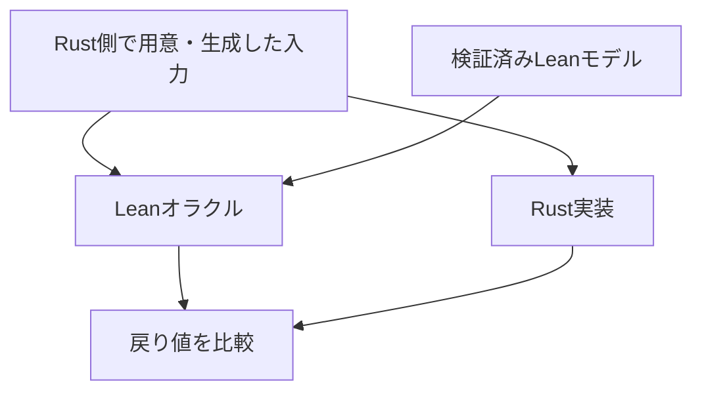

# BoyerMooreDifferentialTest

Leanで検証したBoyer–Moore majority voteアルゴリズムを参照モデルとし、Rust実装を差分テストするプロジェクトである。

Rust側で固定入力・ランダム入力を用意し、Leanオラクル（参照モデルの実行プログラム）とRust実装の戻り値を比較する。

参照モデルと証明には [BoyerMooreVerification](https://github.com/rikitoro/BoyerMooreVerification) を利用する。参照リビジョンは `lakefile.lean` と `lake-manifest.json` で固定する。

## 実行方法

必要な環境は以下のとおりである。

- Git
- Lean / Lake：`elan` 経由でLean 4.35.0を使用（`lean-toolchain` に指定）
- Rust / Cargo：Rust 1.88以降（`proptest 1.12` の要件）

Linux/WSL の bash で実行する。

```bash
git clone https://github.com/rikitoro/BoyerMooreDifferentialTest.git
cd BoyerMooreDifferentialTest

lake build bm_oracle

PROPTEST_RNG_SEED=20261103 \
  cargo test --locked --manifest-path rust/Cargo.toml \
  --test oracle_smoke -- --nocapture
```

以降のコマンドはリポジトリ直下で実行する。

成功時の出力例（表示順は不定）：

```text
test fixed_inputs_match_lean ... ok
test random_inputs_match_lean ... ok
test random_majority_matches_lean ... ok

test result: ok. 3 passed; 0 failed; 0 ignored; 0 measured; 0 filtered out; ...
```

Rust単体テスト7件：

```bash
cargo test --locked --manifest-path rust/Cargo.toml --lib
```

単体テストと差分テストの一括実行：

```bash
PROPTEST_RNG_SEED=20261103 \
  cargo test --locked --manifest-path rust/Cargo.toml -- --nocapture
```

## 仕様と比較条件

Boyer–Moore majority voteアルゴリズムは、厳密に過半数を占める値が存在するとき、その値を返す。

値 `a` の出現回数を `count(a, xs)`、列長を `|xs|` とすると、参照モデルで証明した性質は以下である。

```text
2 * count(a, xs) > |xs| ならば majorityCandidate(xs) = a
```

多数派が存在しない場合も候補値を返す。本プロジェクトでは、この場合もLeanモデルとの一致を検査する。

| 入力 | 候補値 | 意味 |
| --- | ---: | --- |
| `[1, 1, 2]` | `1` | `1` が厳密な多数派 |
| `[1, 2]` | `1` | 多数派なし |
| `[1, 2, 3, 4]` | `3` | 多数派なし |
| `[]` | `0` | 空配列では初期値を返す |

多数派なしの場合の不一致は、モデルとの不一致であり、上記の性質への違反を意味しない。

## 差分テストの構成



入力生成には `proptest` を用いる。`lean_candidate` 関数は入力1件ごとにLeanプロセスを起動し、候補値を取得する。

### テスト一覧

| テスト関数 | 入力数 | 入力の範囲・特徴 | 確認内容 |
| --- | ---: | --- | --- |
| `fixed_inputs_match_lean` | 15件 | 空配列、単一要素、相殺、多数派なし、`u32::MAX`、長さ4096など | 期待値・Lean・Rustの一致 |
| `random_inputs_match_lean` | 100件 | 値0〜3、長さ0〜64 | LeanとRustの一致 |
| `random_majority_matches_lean` | 100件 | 値0〜3、奇数長1〜65、多数派あり | 多数派条件の成立と、Lean・Rustの結果が多数派と一致 |

設定は固定入力15件、ランダム入力200件である。Cargoの件数はテスト関数単位であり、成功時は `3 passed` となる。ランダム入力の成功時ログは省略する。

### 多数派あり入力の生成

`inputs_with_majority` は次の手順で入力を生成する。

1. 多数派にしたい値 `a` と、長さ `n` のランダム列を生成する。
2. `a` を `n + 1` 個用意し、ランダム列を加える。
3. 全体を `prop_shuffle()` で並べ替える。

全長は `2n + 1`、`a` は少なくとも `n + 1` 個となり、過半数条件を満たす。`prop_flat_map` による再構成とシャッフルは、縮小時にもこの条件を保つ。

## Leanオラクルの入出力

`Oracle/Main.lean` は標準入出力でJSON Lines形式のリクエストと応答を扱う。

入力例：

```json
{"id": 1, "votes": [1, 1, 2]}
```

応答例：

```json
{"id": 1, "candidate": 1}
```

入力範囲：

| 項目 | 範囲 |
| --- | --- |
| `id` | 非負整数 |
| `votes` の長さ | 0〜4096 |
| 各票の値 | 0〜4294967295（`u32` の範囲） |

票の型はLeanでは `Nat`、Rustでは `u32` である。オラクルで値域を制限し、不正入力には `error` を含むJSONを返す。

オラクルは複数行に対応する。Rustテストは1行の送信後にEOFを通知し、プロセス終了を待つ。応答のID、エラーの有無、候補値の型・範囲を確認してから結果を比較する。

## ファイル構成

| ファイル | 役割 |
| --- | --- |
| `lean-toolchain` | Leanのバージョン指定 |
| `lakefile.lean` | 検証済みモデルへの依存と `bm_oracle` のビルド設定 |
| `lake-manifest.json` | Lean側の依存関係・参照リビジョン |
| `Oracle/Main.lean` | JSON Linesオラクル |
| `rust/Cargo.toml` | Rustプロジェクトとテスト用依存関係 |
| `rust/Cargo.lock` | Rust側の依存バージョン |
| `rust/src/lib.rs` | Rust実装と単体テスト7件 |
| `rust/tests/oracle_smoke.rs` | オラクル呼び出し、入力生成、差分テスト |

## テスト設定

### テスト件数

`rust/tests/oracle_smoke.rs` の `cases: 100` で各ランダムテストの件数を指定する。この値は `PROPTEST_CASES` 環境変数より優先される。

### 再現用seed

`PROPTEST_RNG_SEED` でseedを指定する。同じコード・依存関係・設定・seedで同じ入力系列を再現する。探索する入力を変える場合はseedを変更する。

依存バージョンは `Cargo.lock` で固定し、実行時は `--locked` を指定する。

### 失敗時の縮小と保存

`proptest` は失敗を再現する小さな入力への縮小を試みる。再現用seedの保存先は以下である。

```text
rust/tests/oracle_smoke.proptest-regressions
```

保存したseedは次回実行時に再試行する。生成器や依存関係の変更後は、同じ入力の再現を保証しない。

## 検証範囲と課題

Rust単体テスト7件と差分テスト3種類の成功を確認済みである。ランダムテストの確認用seedは `20261103` である。

Leanの証明対象は参照モデルである。差分テストは実行した入力上の一致を確認する。Rust実装の全入力に対する正当性や、JSON変換・実行基盤を含む全体の正しさは未証明である。

未確認・未対応の項目：

- [ ] バグ入り実装による検出・縮小・保存・再現の動作確認
- [ ] 入力生成の値域・長さ・配置の拡張
- [ ] 具体的な反例と実行環境の保存・再生
- [ ] Leanプロセスの再利用とタイムアウト処理
- [ ] 差分テストのGitHub Actionsへの組込み
